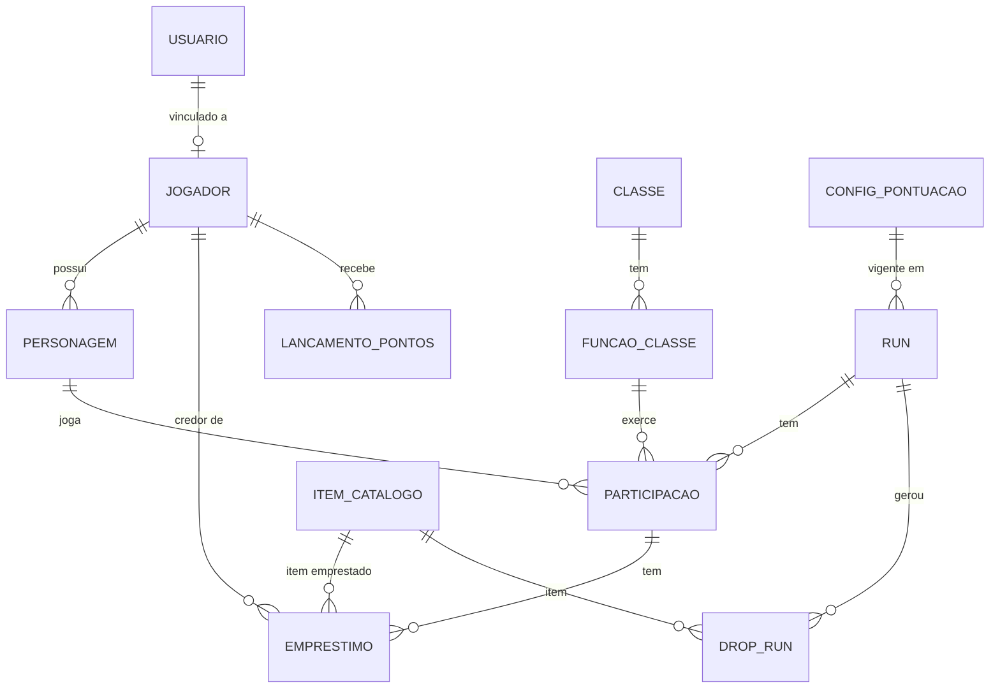

# Etapa 2: arquitetura (Agent 03, consolidado pelo orquestrador)

**Status:** Todas as decisões de negócio desta etapa foram aprovadas (D12–D15). Aguardando o OK do usuário para iniciar a implementação. Nada foi implementado.

**Base:** regras aprovadas em `docs/DECISOES.md` (D1–D11 e D9a).

**Stack aprovada pelo usuário em 2026-11-14:**
- NestJS (TypeScript) no backend
- Angular no frontend
- VPS própria com Docker
- Discord apenas para login (sem bot)

## 1. Visão geral

```
                   ┌──────────── VPS (Docker Compose) ─────────────┐
 Navegador ──HTTPS──► Caddy (TLS automático)                        │
                   │   ├── /        → web   (Angular, estático)      │
                   │   └── /api/*   → api   (NestJS)                 │
                   │                   ├── PostgreSQL 16 (volume)    │
                   │                   └── backup diário (pg_dump)   │
                   └────────────────────────────────────────────────┘
                              api ──OAuth2──► Discord
```

O código fica num monorepo pnpm com três partes:

| Pasta | Conteúdo |
|---|---|
| `backend` | Backend NestJS |
| `web` | Frontend Angular |
| `packages/scoring` | **Motor de cálculo puro** em TypeScript, sem I/O. O backend o usa como fonte da verdade. O frontend usa o mesmo pacote para mostrar uma **prévia dos pontos** enquanto o admin registra a run, então os dois cálculos nunca divergem |

**ORM:** Prisma, com migrations versionadas. As regras de banco que o Prisma não expressa (o trigger que impede alterar lançamentos e os CHECKs) entram em migrations SQL manuais.

## 2. Módulos do backend

| Módulo | Responsabilidade | Histórias |
|---|---|---|
| `auth` | OAuth2 do Discord, sessão e guards de papel | Transversal |
| `jogadores` | Jogadores, personagens e vínculo com o usuário do Discord | Pré-requisito da US-03 |
| `classes` | Classes, funções e ranks | US-01 |
| `config-pontuacao` | Parâmetros versionados (B, α, multiplicadores, categorias, teto) | US-02 |
| `itens` | Catálogo de itens (seed com os itens da Torre) | US-04 |
| `runs` | Registro da run, participações, empréstimos e drops. Orquestra o cálculo | US-03, US-04, US-05 |
| `ledger` | Lançamentos de pontos (só inclusão), saldo e estorno | US-06, US-07 |
| `auditoria` | Registro de quem fez o quê | Transversal |
| *Futuros:* `estoque`, `loja`, `nebula` | Movimentos de estoque, ofertas e compras, receitas | Épicos II e III |

**Regra de dependência:**
- `runs` usa `scoring`, `config-pontuacao`, `classes` e `ledger`.
- `ledger` não conhece `runs`. Ele só recebe comandos do tipo "lançar X para o jogador Y com origem Z".
- Isso deixa a loja futura plugável: comprar será apenas um lançamento negativo com origem `COMPRA`.

## 3. Modelo de domínio



### Entidades principais

**`usuario`**
- `discord_id` (único), `discord_username`, `global_name`, `avatar`
- `papel`: `ADMIN` ou `MEMBRO`
- `ativo`, `ultimo_login`

**`jogador`**
- `apelido`
- `usuario_id` (opcional e único). O jogador pode existir antes de fazer o primeiro login.

**`personagem`**
- `jogador_id`, `nome` (único), `ativo`

**`classe`**
- `nome_oficial`, `apelido_grupo` (por exemplo, "MTK"), `ativa`
- Existe uma classe "Outra" cuja função padrão tem rank 1. Ela cobre o caso "demais classes".

**`funcao_classe`**
- `classe_id`, `nome`, `rank` (CHECK 1–5), `padrao`
- Só pode haver uma função padrão por classe (índice parcial único).

**`config_pontuacao`** (versionada; nunca é editada, só ganha uma nova versão)
- `versao`, `base` (100), `alpha` (0,5)
- `m_naght` (1,0), `m_bet50` (1,5), `m_bet75` (2,0)
- `s_concluida` (1,0), `s_falha` (0,5), `s_abortada` (0)
- `pct_essencial` (20%), `pct_importante` (10%), `pct_complementar` (5%)
- `teto_credores` (50%)
- `vigente_desde`, `criada_por`

**`run`**
- `data`, `chefe` (`NAGHT_25`, `BETELGEUSE_50` ou `BETELGEUSE_75`)
- `status` (`CONCLUIDA`, `FALHA_CHEFE`, `ABORTADA` ou `ESTORNADA`)
- `pontuacao_betelgeuse` (opcional, só informativa)
- `config_id`, `registrada_por`, `corrige_run_id` (opcional), `observacao`

**`participacao`**
- `run_id`, `personagem_id`, `jogador_id`, `funcao_id`, `fracao` (1, 0,5 ou 0)
- Snapshot do cálculo: `rank`, `peso`, `m_chefe`, `s_status`, `pontos_gerados`
- UNIQUE (`run_id`, `personagem_id`)

**`emprestimo`**
- `participacao_id`, `credor_jogador_id`, `item_id` (ou `item_descricao`), `categoria`
- `pct_sugerido`, `pct_informado` (opcional), `pct_efetivo`, `pontos`
- CHECK: o credor tem que ser diferente do tomador.

**`item_catalogo`**
- `nome`, `id_jogo` (ID no bRO), `tipo`
- `negociavel` e `vinculado_conta`: começam nulos (desconhecidos), por causa da lacuna levantada pelo BA.
- `ativo`

**`drop_run`**
- `run_id`, `item_id`, `quantidade` (CHECK maior que 0)

**`lancamento_pontos`** (**append-only**: um trigger bloqueia UPDATE e DELETE)
- `jogador_id`, `valor` (inteiro, com sinal), `tipo`, `criado_por`, `criado_em`
- Origem: `run_id`, `participacao_id`, `emprestimo_id`, `estorna_lancamento_id`
- Tipos de `tipo`:
  - `PARTICIPACAO`: +P
  - `EMPRESTIMO_DEBITO`: −parcela, lançado para quem pegou emprestado
  - `EMPRESTIMO_CREDITO`: +parcela, lançado para o credor
  - `ESTORNO`
  - `AJUSTE_ADMIN`
  - Reservados para o futuro: `COMPRA` e `VENDA`

**`auditoria`**
- `usuario_id`, `acao`, `entidade`, `entidade_id`, `antes`, `depois`, `em`

**Por que o débito e o crédito do empréstimo são lançamentos separados:** o histórico do tomador mostra os pontos originais (+P) e cada parcela (−x), como a seção 5 do épico pede. A soma de todos os lançamentos da run é sempre igual à soma dos P.

**Saldo:** `SUM(valor)` por jogador, servido por uma view. Na loja (Épico II) entra um saldo materializado com bloqueio de linha, para impedir gasto duplo. A estrutura do ledger já comporta isso.

## 4. Motor de cálculo (`packages/scoring`)

- **Só aritmética inteira, sem ponto flutuante.**
  - Peso, multiplicadores e fração são guardados em centésimos.
  - Percentuais são guardados em pontos-base (1% = 100).
- Pontos da participação:
  `P = arredMeio( B × Wc × Mc × Sc × Fc / 100⁴ )`
  - `Wc = 100 + α_c × (r − 1)`, com `α_c = 50`.
  - O arredondamento é feito com divisão inteira (meio para cima).
- Parcela de cada credor:
  - Sem redução: `parcela = ⌊P × pct_bp / 10000⌋`.
  - Com redução proporcional (quando a soma das sugestões passa de `teto_bp`): `parcela = ⌊P × pct_bp × teto_bp / (soma_bp × 10000)⌋`. É exato, sem dízima.
  - Quem pegou emprestado fica com `P − Σ parcelas`.
- Erros de domínio:
  - Um percentual informado pelo admin que passe do teto é **rejeitado**.
  - Credor igual ao tomador é rejeitado.
  - Rank fora de 1–5 é rejeitado.
- O pacote exporta funções puras, `calcularParticipacao(...)` e `dividirEmprestimos(...)`, cobertas pelo plano de testes do QA.

## 5. Autenticação com o Discord

**Fluxo:** OAuth2 *Authorization Code* no lado do servidor, com `state` contra CSRF:

```
/api/auth/discord → discord.com/oauth2/authorize → /api/auth/discord/callback
```

**Escopos mínimos:**

| Escopo | Para quê |
|---|---|
| `identify` | `id` (identificador único e permanente), `username`, `global_name` e `avatar` |
| `guilds.members.read` | Consultar `GET /users/@me/guilds/{GUILD_ID}/member`: confirma que a pessoa está no servidor do grupo e permite, no futuro, ler cargos |

- **Não pedimos `email`.** Não é necessário, e assim evitamos guardar dado pessoal.
- O token do Discord é usado só durante o login e depois descartado.

**Sessão:**
- Sessão no servidor, guardada no Postgres.
- Cookie `httpOnly`, `Secure` e `SameSite=Lax`.
- Expira após 7 dias sem uso.
- As rotas que alteram dados verificam o `Origin`.

**Papéis:**
- O papel `ADMIN` fica no banco local.
- O primeiro admin é definido pela variável `ADMIN_DISCORD_IDS`.
- Admins podem promover e rebaixar outros usuários (com auditoria).

**Associação entre Discord e personagens (D12 aprovada):**
1. No primeiro login, o usuário fica "sem vínculo".
2. Ele envia uma **solicitação de vínculo**: escolhe um `jogador` existente que ainda não tem usuário, ou propõe um novo apelido, e informa seus personagens (existentes ou novos).
3. Um admin aprova ou rejeita, com motivo.
4. Só depois da aprovação o vínculo é criado e os personagens novos são cadastrados.
5. Enquanto a solicitação está pendente, o usuário não vê nenhum saldo.

**Acesso (D13 aprovada):** no callback do login, se `GET /users/@me/guilds/{GUILD_ID}/member` responder 404, o login é recusado com a mensagem "Acesso restrito aos membros do servidor".

Nova entidade **`solicitacao_vinculo`**:
- `usuario_id`, `jogador_id` (ou `apelido_proposto`), `personagens` (jsonb)
- `status` (`PENDENTE`, `APROVADA` ou `REJEITADA`), `motivo`, `analisada_por`, `analisada_em`
- Só pode haver uma solicitação `PENDENTE` por usuário.

## 6. Frontend (Angular)

| Rota | Perfil | Conteúdo |
|---|---|---|
| `/login` | Público | Botão "Entrar com Discord" |
| `/vinculo` | Membro sem vínculo | Formulário de reivindicação e status da solicitação |
| `/me` | Membro | Somente o próprio saldo (D14). Saldo, histórico de lançamentos com a origem detalhada (run, função, peso, multiplicadores, fração, parcelas de empréstimo) e meus personagens |
| `/admin/runs` | Admin | Lista de runs, com filtros por data, chefe e status |
| `/admin/runs/nova` | Admin | Assistente em 5 passos: (1) dados da run → (2) participantes, com função e fração → (3) empréstimos → (4) drops → (5) revisão, com **prévia dos pontos** calculada pelo `packages/scoring` |
| `/admin/runs/:id` | Admin | Detalhe da run e ação "Corrigir", que estorna a run e abre o assistente pré-preenchido |
| `/admin/jogadores` | Admin | Jogadores, personagens e **fila de solicitações de vínculo** (aprovar ou rejeitar) |
| `/admin/classes` | Admin | Classes, funções e ranks |
| `/admin/parametros` | Admin | Versão vigente e histórico; criar nova versão |
| `/admin/itens` | Admin | Catálogo de itens |

**Componentes:** standalone components, Signals e Angular Material (bom para formulários e tabelas administrativos). Os textos ficam em PT-BR.

## 7. Infraestrutura e qualidade

**Docker Compose** com os serviços `caddy`, `web`, `api`, `postgres` e `backup`.

**Backup:**
- `pg_dump` diário, mantendo os últimos 14 dias.
- O teste de restauração é uma tarefa do plano.

**CI (GitHub Actions ou equivalente)** roda em cada PR:
- lint
- testes unitários (`scoring`)
- testes de integração (`api` com Postgres em contêiner)
- build

**Configuração** por `.env`, com `.env.example` versionado:
- `DISCORD_CLIENT_ID`, `DISCORD_CLIENT_SECRET`, `DISCORD_GUILD_ID`
- `ADMIN_DISCORD_IDS`, `DATABASE_URL`, `SESSION_SECRET`

**Seeds:**
- Classes e funções com os ranks aprovados.
- Config v1 com os parâmetros aprovados.
- Catálogo de itens da Torre, com os IDs levantados pelo BA.

## 8. Preparação para os Épicos II e III (sem implementar)

- **Ledger com tipos reservados** (`COMPRA`/`VENDA`): a loja não muda o modelo de pontos.
- **`item_catalogo` com `negociavel` e `vinculado_conta`:** a loja vai usar esses campos para filtrar o que pode ser vendido.
- **Previsto, mas não criado agora:**
  - `movimento_estoque` (entrada e saída, com origem: drop de run, oferta de jogador, compra, Nebula)
  - `receita` e `receita_componente`: Nebula e Sinetes, com as quantidades confirmadas pelo BA
  - `solicitacao_nebula`
- **Drops da run:** a tabela `drop_run` já existe. Quando houver estoque, um drop poderá gerar movimento de entrada, se o grupo decidir que o loot vai para o estoque comum.

## 9. Decisões de negócio levantadas pelo arquiteto

As decisões D12 a D15 foram aprovadas em 2026-11-14. Ver `docs/DECISOES.md`.
